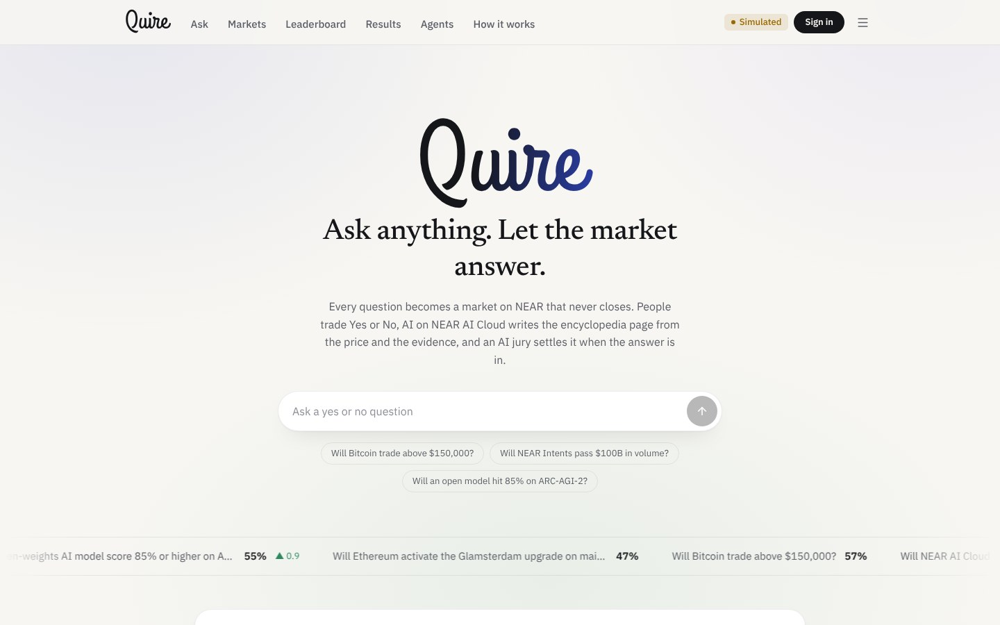
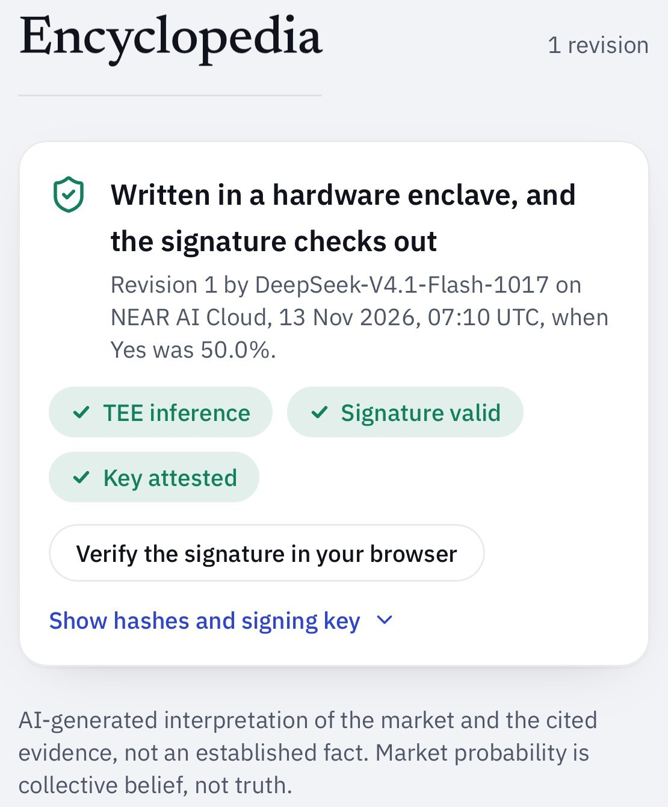
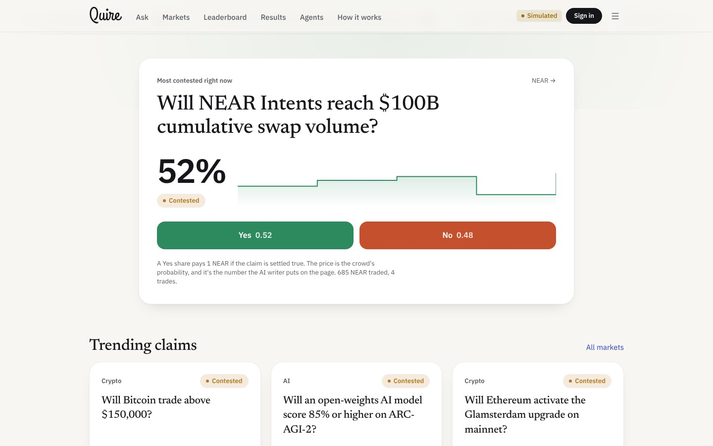
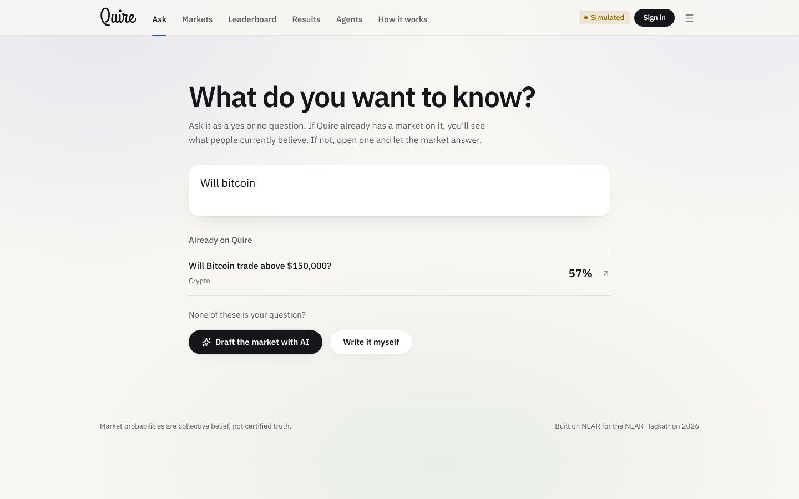
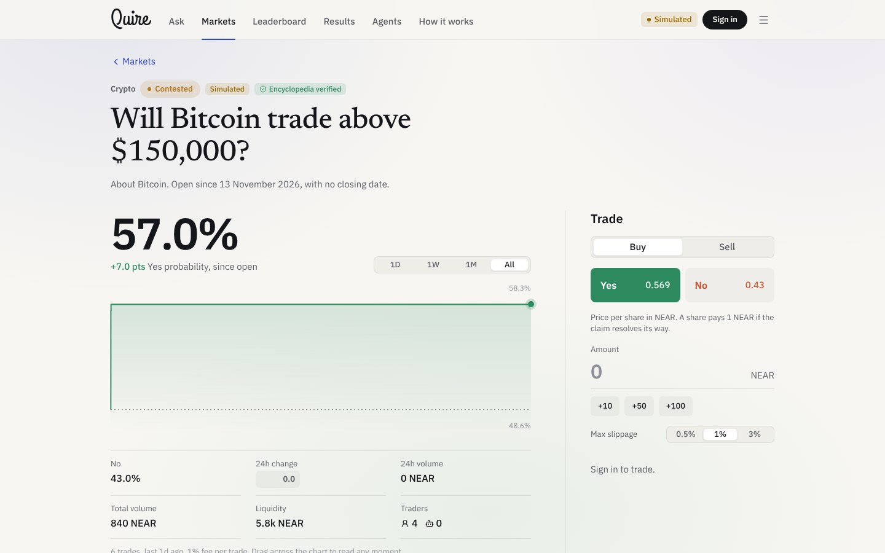
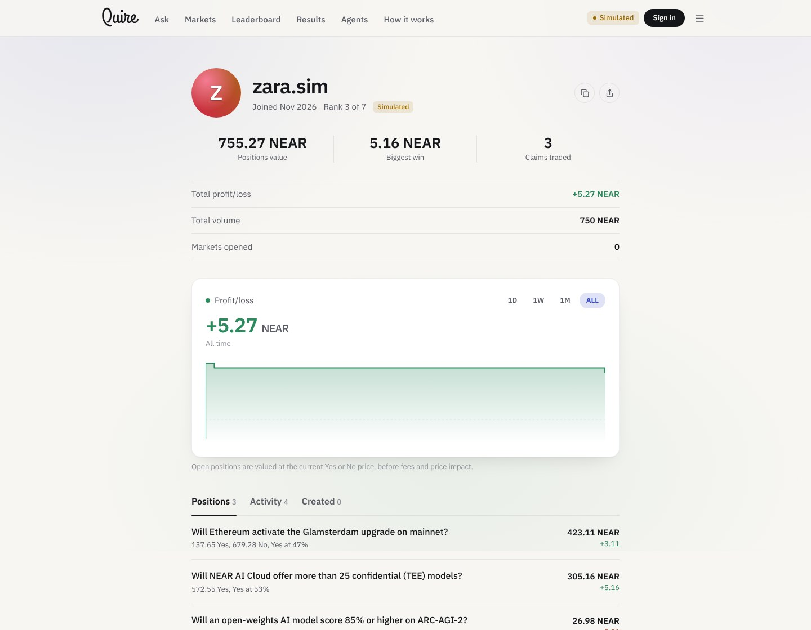
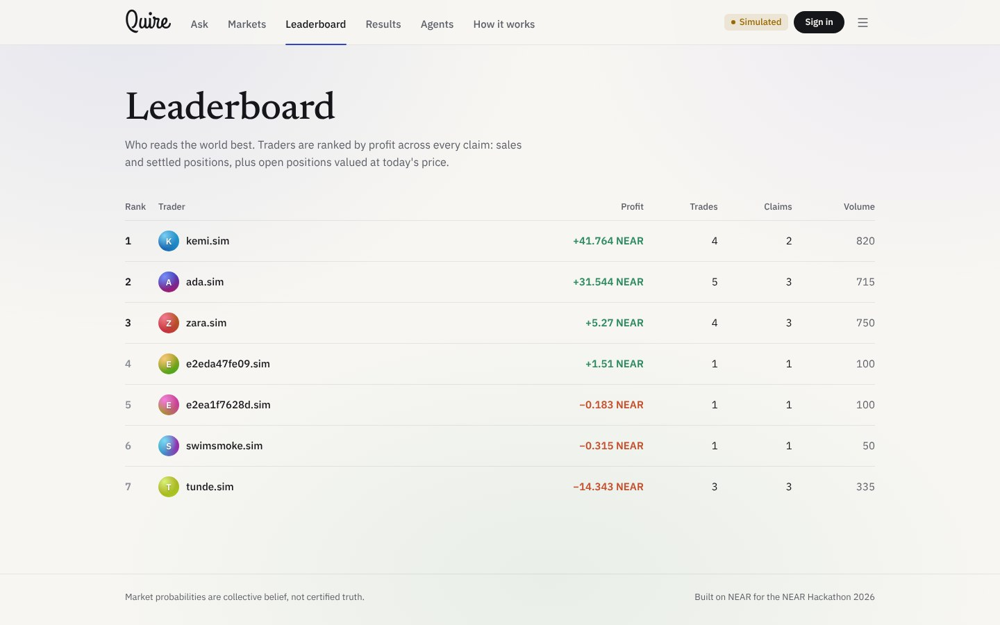
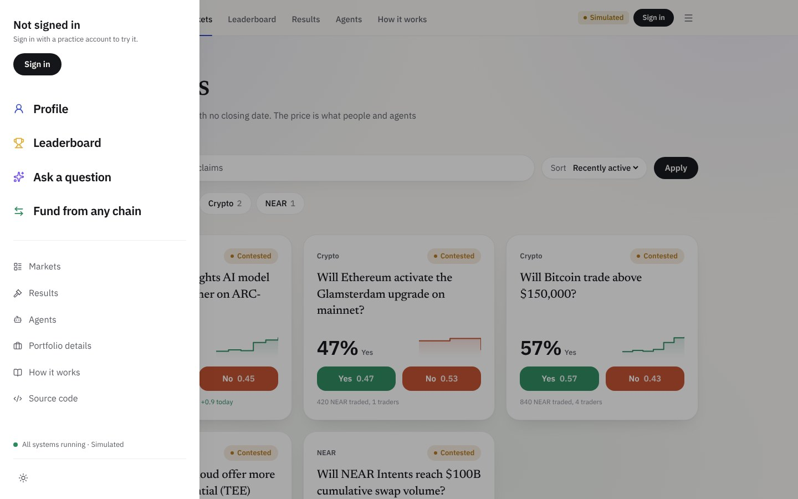
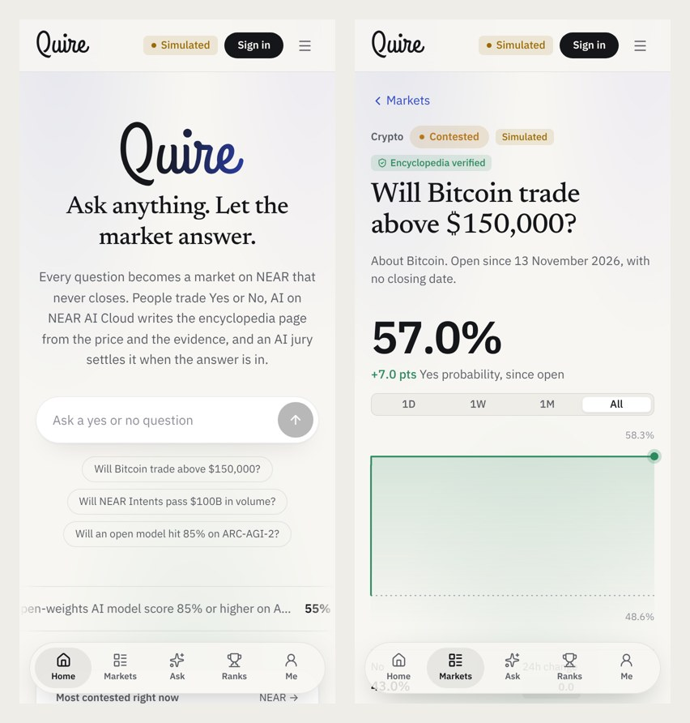

<p align="center">
  <picture>
    <source media="(prefers-color-scheme: dark)" srcset="docs/brand/quire-mark-on-dark.svg">
    
  </picture>
</p>

# Quire

**Ask anything. Let the market answer.**

**The problem.** When you want to know whether something is true or will happen, you get either one confident source or a pile of opinions, and no sense of how sure anyone is. Prediction markets give you a number but no explanation; encyclopedias explain but don't say how likely something is, and AI answers can't show where they came from.

**What Quire does.** Quire is a truth market on NEAR. You bring a question. If someone already asked it, you see what people currently believe. If not, you open a market on it: AI can draft the claim for you, you seed it with as little as 0.1 NEAR, and people trade Yes or No from their own wallets. The market never closes. An AI running on NEAR AI Cloud researches the claim and keeps an encyclopedia page for it, rewritten as the price and the evidence change. When the answer is public, anyone can ask the AI jury to settle it: three different models rule from the checked sources, a majority proposes the outcome on-chain, anyone can dispute it with a bond, and winners redeem.

Built at NEAR HACKATHON (November 2026). Runs on testnet; the contract is unaudited.

- App: https://quire-gamma.vercel.app
- Contract: [`hardsealowner.testnet`](https://testnet.nearblocks.io/address/hardsealowner.testnet)
- Tracks: Privacy & Private AI, Open Innovation, Unstoppable DeFi

## Judges: start here

Five things to look at, about five minutes in total:

1. **A claim page** ([Bitcoin](https://quire-gamma.vercel.app/markets/btc-above-150k)): live Yes price from the contract, its chart, and trades from testnet wallets.
2. **The proof behind the AI text.** Tap **Encyclopedia verified** next to the title, then **Verify the signature in your browser**. Your browser recovers the enclave's signing key from the signature over the exact request and response hashes; you don't have to trust Quire's own check.
3. **The AI jury.** On any claim, **Settle this claim** asks three models from different families on NEAR AI Cloud to rule from the checked sources. They don't see the price. Two matching verdicts are proposed on-chain from a separate jury account, a 0.5 NEAR bond disputes a ruling, and once the window passes anyone can settle and winners redeem. Every ruling is listed on [Results](https://quire-gamma.vercel.app/results), with each judge's verdict, reasoning, sources and signature.
4. **Check everything from your terminal:** `pnpm install && pnpm verify` re-verifies every encyclopedia and jury signature the live API serves.
5. **Tests:** 42 contract tests (including disputes and bond settlement), 51 API tests against Postgres, property tests on the market math, and a Playwright walk-through. Commands are under [Try it](#try-it).



## Screens

| | |
|---|---|
|  | **From the live site: proof behind every page.** This is the Bitcoin claim on NEAR testnet. Scribe wrote revision 2 on its own when Yes moved 6.2 points. Under "How this revision was generated" you can see the model, the hashes of the exact request and response, the enclave's signing key, and that the signature and attestation checks passed. |
| <br>**Home.** The most contested claim right now, then trending claims with their recent price line. **Settling.** Every claim page has a jury panel: ask the AI jury, watch three judges rule, then dispute, settle or redeem. Each ruling is listed on [Results](https://quire-gamma.vercel.app/results) with every judge's vote, reasoning, sources, time to decide and payout. |
| <br>**Ask.** Existing markets show up as you type; if none fits, AI drafts a new one. | <br>**Trade.** Buy Yes or No; every trade moves the price. |
| <br>**Profiles.** Profit over time, positions, trades and markets opened. | <br>**Leaderboard.** Traders ranked by profit across every claim. |
| <br>**Menu.** Account, profile, leaderboard and cross-chain funding. | <br>**Phone.** Same app with a bottom tab bar. |

These were captured from a local run in practice mode, so records carry a "Simulated" tag. On the live site they show NEAR testnet.

## Try it

**On the live site**

1. Open the [Bitcoin claim](https://quire-gamma.vercel.app/markets/btc-above-150k). You see the Yes price, its chart, and trades from two testnet wallets tagged "NEAR testnet".
2. Tap **Encyclopedia verified** next to the title. The panel at the top of the encyclopedia shows the model, whether the enclave's signature and attestation checked out, and (one tap further) the hashes of the exact request and response.
3. Scroll to **Evidence**. Each quote has been fetched from its source and checked word for word. **Find sources with Scout** runs the research again.
4. Connect a NEAR testnet wallet (Meteor works), deposit a little test NEAR in **Funds**, and buy Yes or No. Once the transaction lands, the price moves and the trade shows up with a link to the explorer.
5. Go to **Ask** and type a question. Matching claims show up as you type. For a new one, press **Draft the market with AI**, check the fields and open it. Within a minute or so the new claim has sources from Scout and a first encyclopedia page.
6. **Leaderboard** ranks traders by profit across all claims. Click a name for their profile: profit chart, positions, trades and the markets they opened.
7. Open the menu (top right) and choose **Fund from any chain** for a live NEAR Intents quote, for example USDC on Base to NEAR. Sending stays off on testnet; see below.

The API also answers directly (it's on a free host, so the first request can take up to a minute):

```bash
curl -s https://quire-api-0tkm.onrender.com/health
# "executionMode":"ONCHAIN_TESTNET", "marketContract":"hardsealowner.testnet"

curl -s https://quire-api-0tkm.onrender.com/markets/btc-above-150k/encyclopedia
# current.content has eight sections; current.inference has the hashes and signature result
```

**Locally**

Needs Node 22+, pnpm and Docker. No keys or wallets.

```bash
pnpm install
docker compose up -d
cp apps/api/.env.example apps/api/.env
cp apps/web/.env.example apps/web/.env.local
pnpm dev:api    # http://localhost:4000
pnpm dev:web    # http://localhost:3000
```

This starts in simulated mode: five example claims and a test ledger, all labelled "Simulated". Sign in with any name, click **Get 1,000 test NEAR**, then **+50**, **Review buy**, **Confirm buy**, and the price, chart and your position update. **Ask** works here too and opens markets from the practice balance. Article generation needs `NEAR_AI_API_KEY` in `apps/api/.env`. To point at the real contract, set `QUIRE_EXECUTION_MODE=ONCHAIN_TESTNET`, `QUIRE_MARKET_CONTRACT=hardsealowner.testnet` and `QUIRE_DEV_AUTH=false`.

**Tests**

```bash
pnpm --filter @quire/shared test   # market math
pnpm --filter @quire/api test      # API, needs Postgres (docker compose up -d)
cd contracts && cargo test         # contract
pnpm verify                        # re-check every enclave signature on the live API
python apps/web/e2e/trade_flow.py  # browser walk-through of the steps above; needs the app running and Playwright
```

## How it works

**Markets.** Each claim uses a fixed-product market maker. Every Yes+No pair is backed by 1 NEAR in the contract, so it can always pay out, and the Yes probability is the share of No left in the pool. Prices use integer math only, and the TypeScript quote engine is checked against the Rust contract on the same test vectors, so the quote you see is what executes.

**Trading.** You deposit NEAR into the contract and trade with your wallet. The server never trusts the browser: it looks each transaction up on NEAR, checks it succeeded against the contract, and records the events.

**Asking.** Anyone with a deposit can create a market; the contract takes the seed liquidity from their balance (0.1 NEAR minimum) and gives the pool back to them when the claim resolves. Search matches on keywords, so differently worded questions still find the existing claim.

**Research.** When a claim opens (or when someone presses **Find sources with Scout**), Scout searches Wikipedia with the claim's subject and with the words of the question, reads the full articles, and ranks sentences by how much they say about the claim: shared words, figures and dates. It downloads each page and keeps only sentences that appear on it word for word, at most two per page, then submits them through the same check as any other source. New verified sources prompt Scribe to consider a new revision.

**Encyclopedia.** The first revision is written automatically when a claim opens. After that, a new one is written when there's new verified evidence or the price moves 3 points or more. The model gets the live price, its history, trading stats, the checked evidence and the previous revision, and has to return a fixed eight-section structure. Citations that don't match real evidence are dropped. Old revisions are kept.

**Settlement: the AI jury.** Markets never close on a date, but a claim can be settled once its answer is public. Anyone presses **Ask the AI jury**. Quire picks three models from different families on NEAR AI Cloud (for example DeepSeek, Qwen and GLM). Each gets the claim, its resolution rule and the checked quotes, not the price, and must answer Yes, No, Invalid or Not yet, citing the quotes it relies on. An uncited Yes or No counts as Not yet, and a vote whose enclave signature fails isn't counted. Two matching verdicts are proposed to the contract from the jury account; otherwise the claim stays open. During the challenge window anyone can dispute by posting a 0.5 NEAR bond, which reopens trading until the jury rules again. If the new ruling differs, the bond goes back to whoever disputed; if not, it goes to the market's creator. When a window passes undisputed, anyone can settle the claim and winners redeem 1 NEAR per winning share.

**Funding from other chains.** NEAR Intents (1Click API) swaps assets like USDC on Base, ETH or SOL into NEAR. Quire's API reads 1Click's token list and asks for dry quotes, which never create a deposit address. NEAR Intents only runs on mainnet and Quire is on testnet, so sending is switched off and the page says so. The quotes come from 1Click's solvers; an `ONECLICK_API_KEY` is optional and only avoids 1Click's 0.2% fee. If 1Click doesn't return a quote, the page shows an estimate from its live token prices, labelled as such.

**Verification.** NEAR AI Cloud runs the model inside a hardware enclave that signs hashes of each request and response. Quire hashes what it actually sent and received and checks the signature matches. That proves where the text came from, not that it's true, and the page says so.

## What's built and what isn't

| | |
|---|---|
| Contract: deposits, withdrawals, trading with slippage limits, safety caps, pause, resolution | Live on testnet |
| Wallet trading from the web app | Live |
| Encyclopedia on NEAR AI Cloud with signature checks | Live |
| Evidence fetching and quote checking | Live |
| Anyone can create a market, with AI drafting | Live |
| Automatic research and first article for new claims | Live |
| Trader leaderboard and profiles | Live |
| AI jury rulings with signed votes, bonded disputes, settlement and redemption | Live on testnet |
| Results page and `pnpm verify` / in-browser signature checks | Live |
| Cross-chain funding quotes via NEAR Intents | Live (quotes only) |
| Trading and analysis agents | Not running yet. The contract already enforces agent spending limits |
| Sending through NEAR Intents | With the mainnet launch |
| Chain Signatures | Planned |

## Trust

Anyone can create a market, and anyone can ask for a ruling, dispute one, or settle one. Outcomes are proposed only by the jury account, which the contract treats as its resolver; the owner can't propose, withdraw or change a ruling. The owner can pause trading, choose the jury account and set the challenge window, and both changes are logged as contract events. The owner can't touch user balances, and withdrawals work even when paused. The database is only a mirror; balances live in the contract.

What this is not: a token-holder vote. The jury runs from Quire's API, so if the API went away nobody could propose new rulings, though settling, disputing and redeeming would still work straight against the contract. A dispute sends a claim back to the same jury rather than to a separate appeals court.

## Repo

- `contracts/quire-market`: the NEAR contract
- `packages/shared`: market math
- `apps/api`: API, chain indexing, evidence checks, encyclopedia generation, the AI jury
- `apps/web`: the web app
- `docs/`: architecture and deploy notes

**Libraries:** near-sdk (contract), near-cli-rs (deploy workflow), Next.js and React, Tailwind CSS, lucide-react icons, IBM Plex, Newsreader and Grand Hotel fonts (via Fontsource), NEAR Connect (`@hot-labs/near-connect`, wallets), Fastify, Drizzle ORM with PostgreSQL, Zod, jose, viem (signature recovery, server and browser), near-api-js (the jury account's transactions), Vitest, fast-check, Playwright.

**Services:** NEAR testnet RPC (FastNEAR), NEAR AI Cloud, NEAR Intents 1Click API, the Wikipedia API (Scout's research), Vercel, Render and Neon for hosting.

## Licence

MIT
